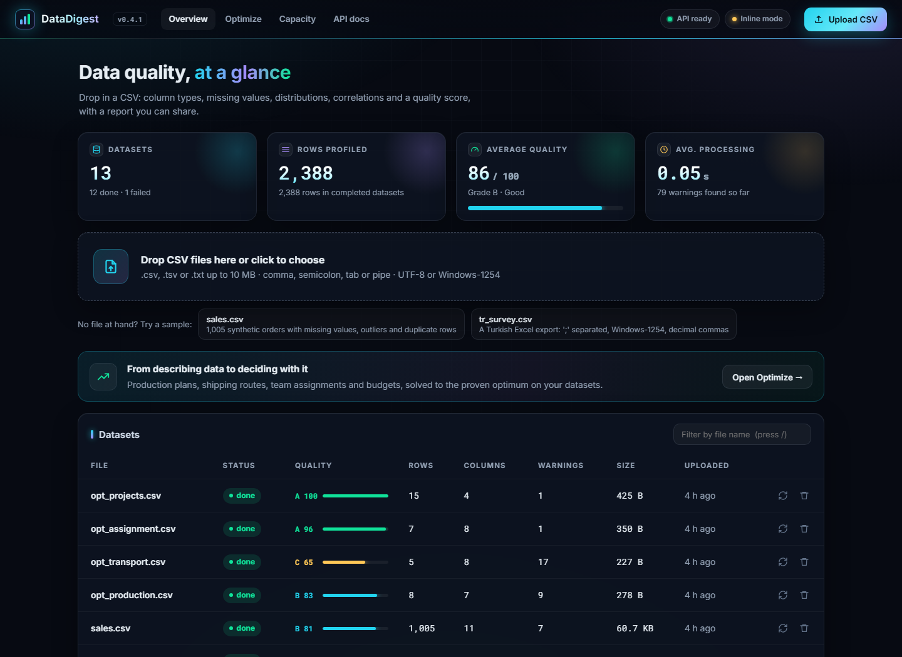
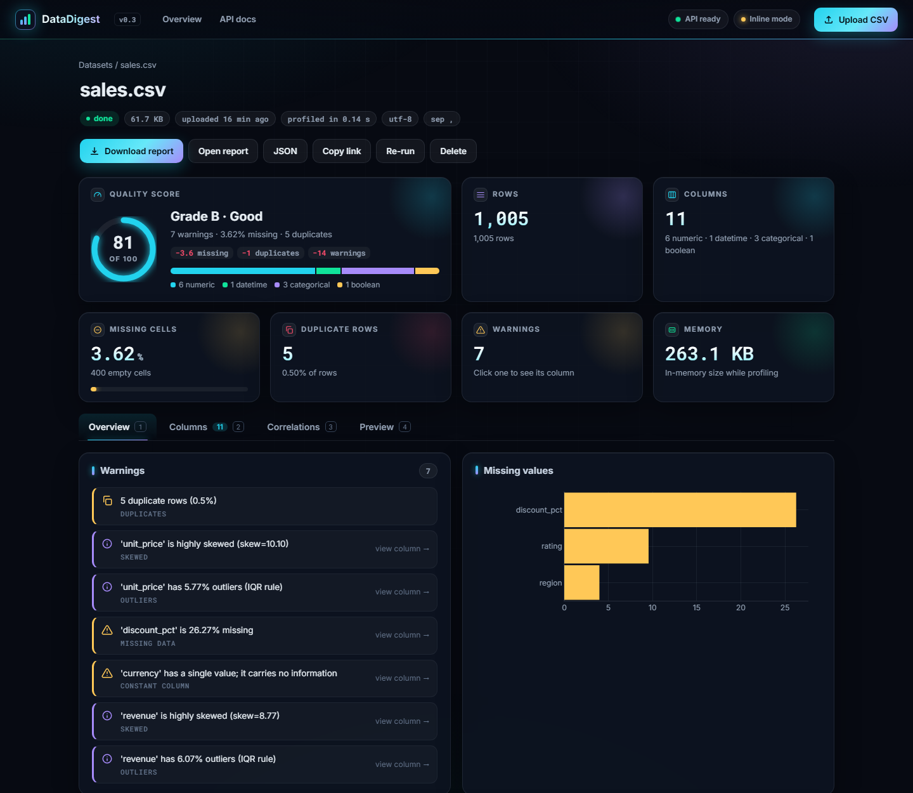
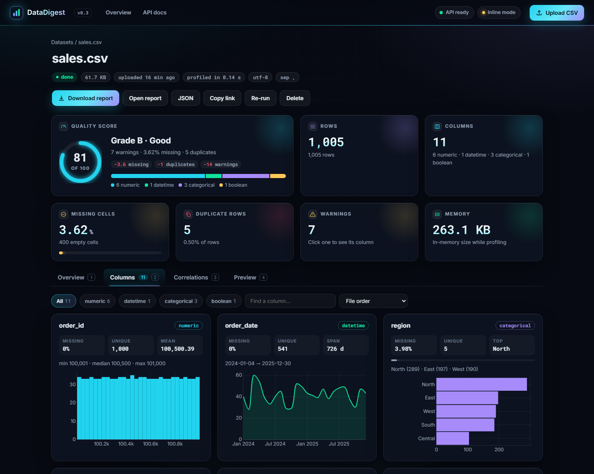
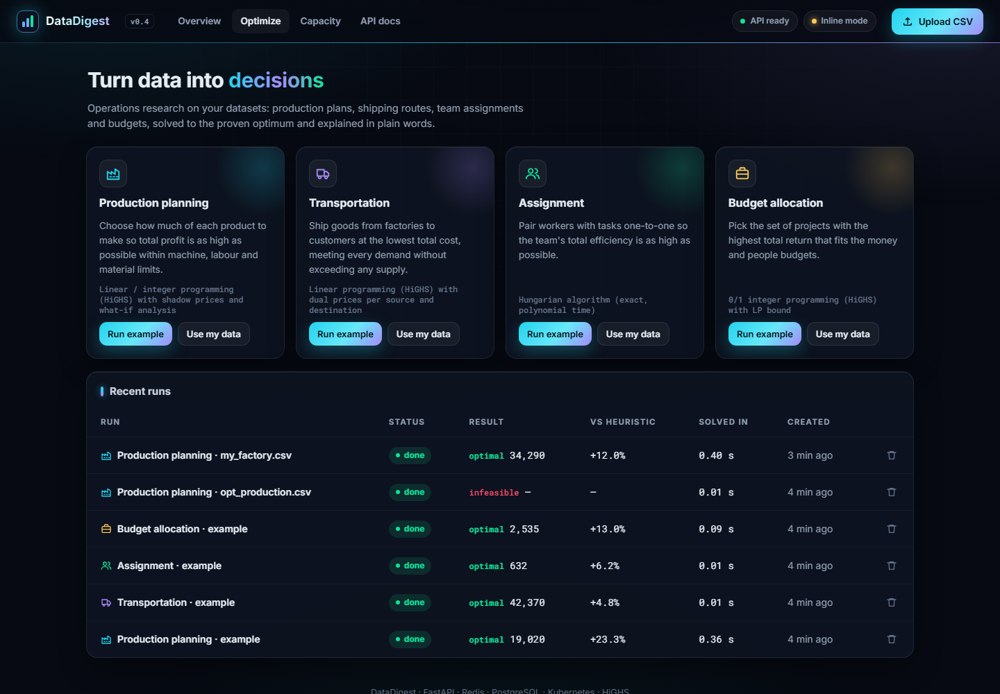
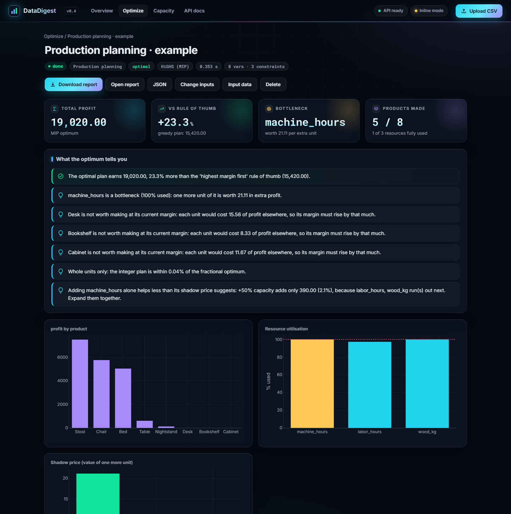
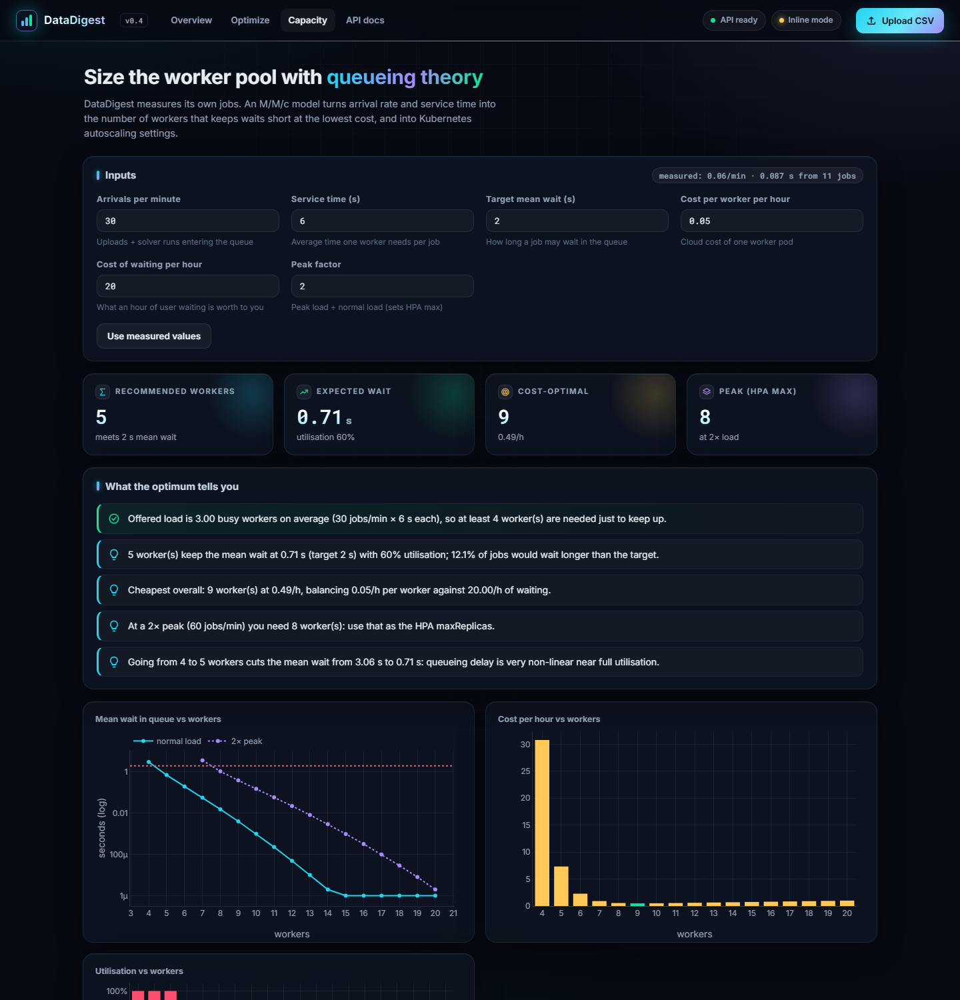
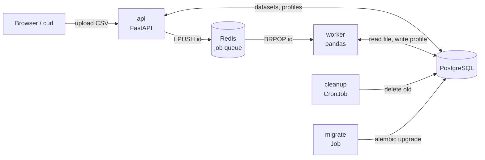

# DataDigest

[](https://github.com/Obejarl/datadigest/actions/workflows/ci.yml)


Upload a CSV and get an automatic data-quality profile: column types, missing values,
distributions, correlations, warnings and a shareable HTML report. Then **optimise** on the
same data with operations research: production plans, shipping routes, team assignments
and budgets, solved to the proven optimum and explained in plain words.

Built as a small but complete service: a REST API, a background worker behind a Redis
queue, PostgreSQL, Docker Compose, Kubernetes manifests (with autoscaling and a CronJob)
and CI that tests against real databases.







## What it does

- **Reads messy real-world CSVs.** It detects the encoding (UTF-8, Windows-1254, Latin-1)
  and the delimiter (`,` `;` tab `|`), and understands decimal commas and `dd.mm.yyyy`
  dates, so an Excel export from a Turkish locale works without extra options.
- **Profiles every column.** It infers each column's type (numeric, categorical, datetime,
  boolean or text) and computes stats, histograms, top values, timelines and a Pearson
  correlation matrix.
- **Flags data-quality problems.** These include duplicate rows, heavily missing columns,
  constant columns, likely ID columns, skewed distributions, outliers (IQR rule) and highly
  correlated pairs.
- **Scores data quality.** Every file gets a 0-100 quality score with an A-D grade, built
  from missing cells, duplicates and weighted warnings
  ([`quality_score`](datadigest/core/profile.py)). The breakdown is shown next to the
  score, so the number explains itself.
- **Reports.** You get an interactive dashboard and a single-file HTML report. Both are
  drawn from the same Plotly specs. The dashboard has tabs for overview, column cards
  (filter by type, sort by missing or unique values), correlations and a preview of the
  first rows. Warnings link to their column. Tab links are shareable (`#columns`), and
  the `1`-`4` keys switch tabs.
- **Scales past pandas.** Files that do not fit in one process's memory are profiled by
  [Apache Spark](https://spark.apache.org/) instead, with the same output (see
  [Big files with Spark](#big-files-with-spark)).
- **Friendly to first-time visitors.** One-click sample datasets, multi-file upload with
  progress, re-run and delete from the list, and keyboard access throughout.
- **Recovers from crashes.** If a worker dies mid-job, the cleanup CronJob marks the job
  failed after 15 minutes and the UI offers "Try again" instead of spinning forever.

## Operations research



Pick a problem type, run the bundled example in one click, or point it at your own
dataset (the form is built from the file's columns). Solvers run on the same queue and
workers as profiling.

| Problem | Decides | Method | Output beyond the plan |
|---|---|---|---|
| **Production planning** | How much of each product to make for maximum profit under machine, labour and material limits | LP / MIP with HiGHS | Shadow price of every resource, opportunity cost of products left out, integrality gap, what-if curve on the bottleneck |
| **Transportation** | Who ships how much to whom at minimum cost | LP with HiGHS | Value of +1 supply per source, cost of +1 demand per destination, Sankey of flows |
| **Assignment** | One-to-one pairing of people and tasks for the best team total | Hungarian algorithm | Who gives up their personal best task, and by how much |
| **Budget allocation** | Which projects to fund under several budgets | 0/1 MIP with HiGHS | LP upper bound and gap; which projects the optimum swaps versus the ranking rule |

Every result is compared with the rule of thumb people actually use (highest margin
first, cheapest route first, best pair first, best value-per-cost first). On the bundled
examples the optimum is **23%, 5%, 6% and 13% better**.

The numbers are verified, not just plausible: tests check each optimum against brute
force, and each shadow price or dual against re-solving with one more unit.



### Capacity planning for DataDigest itself



The `/capacity` page applies queueing theory (M/M/c, Erlang C) to DataDigest's own
workers. Arrival rate and service time are measured from completed jobs, or you can
enter a scenario (shareable as a link). It reports:

- the fewest workers that meet a target mean wait;
- the cost-optimal count (worker cost against waiting cost);
- the count needed at peak load;
- ready-to-paste `minReplicas`/`maxReplicas` for the worker HPA.

## Big files with Spark

pandas loads a whole file into one process's memory. For files that do not fit, the same
profile can be computed by Apache Spark, which reads the file in partitions and runs every
statistic as a distributed aggregation. The result is the **same JSON**, so the dashboard,
charts, quality score and HTML report work unchanged
([`spark_profile.py`](datadigest/core/spark_profile.py)).

```bash
pip install -r requirements-spark.txt          # pyspark; also needs a Java 17+ runtime
python -m datadigest.cli report big.csv --engine spark
python -m datadigest.cli report facts.parquet  # Parquet always uses Spark
```

**In the app.** Uploads stop at 10 MB because they are stored in the database. A bigger file goes
into a folder on the server instead (`LARGE_DATA_DIR`, for example a mounted volume) and is
registered by name; the dashboard lists such files under the samples, and the worker reads them
from disk:

```bash
LARGE_DATA_DIR=/data REDIS_URL=redis://localhost:6379/0 python -m datadigest.worker
curl -X POST http://localhost:8000/api/server-files/orders-2026.csv      # 202, then poll the dataset
```

The engine is picked per file (`auto`): Spark for Parquet and for files of at least `SPARK_MIN_MB`
(default 100), pandas otherwise or when Spark is not installed. Server-side files can be profiled but
not optimized, because the optimizers read the stored upload. `docker build --target spark .` builds
an image with Java and pyspark for those workers; releases publish it as `ghcr.io/obejarl/datadigest:spark`.

**Is it the same?** A test runs both engines on the sample files and on a deliberately messy one
(missing values, duplicate rows and headers, a Windows-1254 file with decimal commas, a byte-order
mark, bad dates) and compares the whole profile. Known, deliberate differences: above 5 million rows
quantiles are approximate (the exact algorithm keeps every distinct value in memory); a row with the
wrong number of fields is padded instead of failing the file; line breaks inside quoted fields are not
supported (they would stop Spark from splitting the file); the "memory" figure is the size on disk.

**Is it faster?** No, and it is not meant to be. Spark pays for starting a JVM and for shuffling data
between partitions, so on one machine pandas wins as long as the file fits in memory:

| Rows | File | Engine | Profile time | Wall time (incl. start-up) | Peak memory |
|---:|---:|---|---:|---:|---:|
| 100,000 | 5 MB | pandas | 0.2 s | 0.9 s | 139 MB |
| 100,000 | 5 MB | spark | 26.6 s | 27.5 s | 1,431 MB |
| 1,000,000 | 47 MB | pandas | 2.3 s | 3.0 s | 454 MB |
| 1,000,000 | 47 MB | spark | 42.1 s | 43.2 s | 2,712 MB |
| 5,000,000 | 241 MB | pandas | 10.8 s | 11.6 s | 1,913 MB |
| 5,000,000 | 241 MB | spark | 84.0 s | 85.0 s | 4,847 MB |
| 20,000,000 | 979 MB | pandas | 44.0 s | 44.7 s | 7,510 MB |
| 20,000,000 | 979 MB | spark | 226.9 s | 227.9 s | 5,060 MB |

(Windows 11, 24 threads, 32 GB RAM, Spark in local mode with a 4 GB driver, 8 columns of synthetic
sales data. Peak memory counts the whole process tree, so it includes Spark's JVM.)

What it shows: pandas is faster at every size tested, because Spark pays for starting a JVM and for
shuffling data between partitions. The picture changes only in memory. pandas grows with the file
(about 375 MB per million rows here, so roughly 37 GB for 100 million rows, more than this machine
has), while Spark stays near its driver size and keeps working. At 20 million rows they are already
in the same range (7.5 GB against 5.1 GB). Spark's real advantage is a cluster, where the partitions
are spread over many machines; in local mode it only helps with files that do not fit in RAM.

This is why `auto` keeps small files on pandas. Reproduce the table with `python scripts/benchmark_engines.py 1000000 5000000`.

## Reliability and observability

**Jobs are not lost when a worker dies.** The queue
([`jobqueue.py`](datadigest/jobqueue.py)) gives *at-least-once* delivery, the same
contract as RQ, Celery or SQS:

1. A worker takes a job with one atomic `BLMOVE` from the queue to a *processing* list.
2. The worker acks the job only after its handler returns.
3. If the worker crashes, the job stays in *processing*. Housekeeping moves it back to the
   queue after `JOB_VISIBILITY_SECONDS`.
4. After `MAX_JOB_ATTEMPTS` the job goes to a *dead-letter* list, and the dataset or run
   is marked failed.

Handlers are idempotent (re-running overwrites the result), which at-least-once
requires. Workers also wait out Redis or PostgreSQL outages with exponential backoff
instead of crash-looping.

**Everything is measured.** The API serves Prometheus metrics at `/metrics`, and each
worker serves its own on port 9100:
- request rate and latency per route template;
- job duration, queue wait and outcome per job kind;
- queue depth (pending, in flight, dead);
- retries, dead letters, crashes and backoffs.

`docker compose --profile monitoring up` adds Prometheus (`:9090`) and Grafana (`:3000`).
Grafana comes with a provisioned **DataDigest** dashboard (10 panels, generated by
[`deploy/grafana/make_dashboard.py`](deploy/grafana/make_dashboard.py)). In Kubernetes,
the pods carry `prometheus.io/*` annotations.

Nine **alert rules** ([`deploy/prometheus/alerts.yml`](deploy/prometheus/alerts.yml)) watch for a
dead API or worker, dead-letter jobs, a queue backlog, jobs stuck in flight, handler crashes, high
queue wait or API latency, and a rising 5xx rate. Each one is unit-tested with `promtool` against
synthetic metrics. Prometheus shows firing alerts on `:9090/alerts`; add Alertmanager to be notified.

CI proves all of this on every push:
- **Compose job:** Prometheus scrapes the API and both workers and counts the finished
  jobs, loads the alert rules, and Grafana's data source and dashboard are checked.
- **Kubernetes job:** it scales the workers to zero, abandons a job the way a crashing
  worker would, starts a fresh worker, and checks that the job is requeued and finished.

## Access control

Off by default, so local use and the demos need no login. To require one, set `ACCESS_TOKEN`:

```bash
python -c "import secrets; print(secrets.token_urlsafe(32))"   # make a long random token
echo ACCESS_TOKEN=<the token> >> .env                          # local; Compose reads it too
```

In Kubernetes, uncomment `ACCESS_TOKEN` in `k8s/secret.yaml`. Then every page and API call needs
the token: a sign-in page sets an HttpOnly, SameSite=Lax session cookie (it holds an HMAC of the
token, never the token), and scripts send `Authorization: Bearer <token>`. Wrong tokens are
throttled (5 per minute per address) and compared in constant time. `/healthz`, `/readyz`,
`/metrics` (counts and route names, no data), the login page and static files stay open so
probes and Prometheus keep working. See [SECURITY.md](SECURITY.md).

## Backups and restores

- **Redis** writes an append-only file to a volume (Compose volume, Kubernetes PVC).
- **PostgreSQL** is dumped nightly by the `postgres-backup` CronJob into its own volume. Each
  dump is read back (`pg_restore --list`) before old ones (older than 7 days) are deleted.

Take one on demand and prove it restores (the second Job restores into a scratch database and
never touches the live one):

```bash
kubectl -n datadigest create job --from=cronjob/postgres-backup backup-now
kubectl -n datadigest apply -f k8s/ops/restore-check-job.yaml
kubectl -n datadigest logs job/restore-check          # prints how many datasets came back
```

To restore for real, scale the API and workers to zero, then
`pg_restore --clean --if-exists --no-owner --dbname=datadigest <dump>` from a pod that mounts
the `postgres-backups` volume. With Compose:

```bash
docker compose exec -T postgres pg_dump -U datadigest -Fc datadigest > backup.dump
docker compose exec -T postgres pg_restore -U datadigest --clean --if-exists -d datadigest < backup.dump
```

## Architecture



1. `POST /api/datasets` (or `POST /api/optimizations`) stores the job and returns **202 Accepted**
   right away. Queue entries carry their kind (`dataset:<id>`, `optimization:<id>`).
2. A worker takes the job from Redis, profiles the file or runs the solver, and writes the
   result as JSONB to PostgreSQL.
3. The client polls `GET /api/datasets/{id}` until the status is `done`.

The API answers quickly no matter how big the file is, and workers scale on their own.
Without `REDIS_URL` the API processes uploads itself (inline mode), so local development
needs no extra services.

One Docker image runs every role:

| Role | Command |
|---|---|
| api | `uvicorn datadigest.api.main:app` (default) |
| worker | `python -m datadigest.worker` |
| migrate | `alembic upgrade head` |
| cleanup | `python -m datadigest.cleanup` |

## API

| Method | Path | |
|---|---|---|
| `POST` | `/api/datasets` | Upload (multipart `file`). `202` on success; `413` over the size limit, `415` wrong type |
| `GET` | `/api/datasets` | Recent datasets (no file contents) |
| `GET` | `/api/datasets/{id}` | Status and summary |
| `GET` | `/api/datasets/{id}/profile` | Full profile JSON (`409` until done) |
| `GET` | `/api/datasets/{id}/charts` | Plotly figure specs |
| `GET` | `/api/datasets/{id}/report` | HTML report (`?download=true` to save) |
| `POST` | `/api/datasets/{id}/reprocess` | Run the analysis again (`409` while queued/processing) |
| `DELETE` | `/api/datasets/{id}` | Delete dataset and file |
| `GET` | `/api/optimize/kinds` | Problem types, parameter schemas and examples |
| `POST` | `/api/optimizations` | Run a solver on a dataset: `{dataset_id, kind, params}` (`202`, `422` on bad params or unknown columns) |
| `POST` | `/api/optimize/examples/{kind}` | Load the example data and solve it in one call |
| `GET` | `/api/optimizations`, `/api/optimizations/{id}` | Runs, and one run with its full result |
| `GET` | `/api/optimizations/{id}/report` | Optimization report as HTML |
| `GET` | `/api/capacity` | M/M/c worker sizing; missing inputs come from measured job history |
| `GET` | `/api/server-files` | Files in `LARGE_DATA_DIR` that can be registered (`enabled: false` when unset) |
| `POST` | `/api/server-files/{name}` | Profile a file from `LARGE_DATA_DIR` (`202`; `404` for names that are not plain files in that folder) |
| `GET` | `/api/samples` | Bundled demo files |
| `POST` | `/api/samples/{name}` | Create a dataset from a demo file |
| `GET` | `/api/stats` | Totals for the dashboard: datasets by status, rows, average quality and processing time, mode, queue depth |
| `GET` | `/healthz`, `/readyz` | Liveness / readiness |
| `GET` | `/metrics` | Prometheus metrics (requests, jobs, queue, datasets) |

Interactive docs: `http://localhost:8000/docs`

## Running it

### 0. Windows: one double-click

`DataDigest.bat` installs the Python environment, starts the app and opens the dashboard.
It also has a menu for Docker, demo data, health checks, tests and stopping
(`DataDigest.bat start|docker|monitoring|demo|health|test|stop`).

### 1. CLI only (no services)

```bash
python -m venv .venv && .venv\Scripts\activate      # Linux/macOS: source .venv/bin/activate
pip install -r requirements-dev.txt
python -m datadigest.cli report samples/tr_survey.csv -o report.html
```

### 2. Local API (SQLite, inline mode)

```bash
alembic upgrade head
uvicorn datadigest.api.main:app --reload
```

Open http://localhost:8000 and drop `samples/sales.csv` on the page.

### 3. Docker Compose (PostgreSQL + Redis + 2 workers)

```bash
docker compose up --build
```

### 4. Kubernetes (Docker Desktop, kind or minikube)

```bash
docker build -t datadigest:0.7.0 .
# kind: kind load docker-image datadigest:0.7.0   minikube: minikube image load datadigest:0.7.0
cp k8s/secret.example.yaml k8s/secret.yaml           # then change the password
kubectl apply -k k8s/
kubectl -n datadigest get pods -w
kubectl -n datadigest port-forward svc/api 8000:80
```

The worker HPA needs `metrics-server`, which Docker Desktop does not ship. Install it with:

```bash
kubectl apply -f https://github.com/kubernetes-sigs/metrics-server/releases/latest/download/components.yaml
```

On Docker Desktop, also add `--kubelet-insecure-tls` to its container args.

## Tests and CI

```bash
ruff check . && ruff format --check .
pytest --cov=datadigest --cov-fail-under=90    # unit tests: SQLite + fakeredis (coverage ~95%)
python scripts/check_manifests.py              # cross-checks selectors, ports, refs, env vars
pip install -r requirements-spark.txt          # optional, needs Java 17+
pytest -m spark                                # the Spark engine must match pandas
pip install -r requirements-e2e.txt && playwright install chromium
pytest tests_e2e                               # browser tests (E2E_BROWSER_CHANNEL=msedge uses Edge)
```

`scripts/smoke_test.sh <url>` checks a running deployment end to end. It waits for
`/readyz`, profiles a sample, solves all four optimization examples and calls the capacity
planner (set `ACCESS_TOKEN` if the server requires one).

GitHub Actions runs seven jobs on every push:
- **test:** lint, unit tests with a 90% coverage gate, manifest checks and `kubeconform`
  schema validation;
- **spark:** the Spark engine against pandas (coverage gate on the Spark module), plus a
  benchmark run;
- **integration:** tests against real PostgreSQL and Redis service containers, including a
  migration up/down/up and all four optimizers through the queue;
- **browser:** [Playwright](https://playwright.dev/) drives a real browser through the dashboard:
  uploading files, tabs and keyboard shortcuts, the delete dialog, the optimizer flow,
  "Change inputs", the capacity page, phone-width layout including charts, and the sign-in flow;
- **docker:** a Docker build, then that smoke test against the running container (which
  proves the SciPy solver and the sample files are in the image), and a build of the Spark
  variant that profiles a sample with Spark inside it;
- **compose:** the full `docker compose` stack (PostgreSQL, Redis, migration, API, two
  workers, Prometheus, Grafana) and these checks:
  - the smoke test through the queue, and both workers processed jobs;
  - `promtool` validates the alert rules and unit-tests that each alert fires;
  - Prometheus scrapes three targets, loaded the rules, and nothing fires on a healthy system;
  - jobs queued while no worker runs survive a Redis restart;
- **kubernetes:** a real cluster with [kind](https://kind.sigs.k8s.io/), then
  `kubectl apply -k k8s/` and these checks:
  - the StatefulSet, the migration Job and the Deployments become ready, with no crash
    loops;
  - the smoke test passes through the Service;
  - a job abandoned by a dead worker is requeued and finished;
  - queued jobs survive a Redis pod replacement;
  - a database backup is taken and restored into a scratch database;
  - the cleanup CronJob runs once;
  - after the API and database pods are deleted, the data is still there.

Pushing a tag such as `v0.7.0` runs the **release** workflow: it checks that the tag matches
the version in the code and in `CHANGELOG.md`, smoke-tests the image (and the Spark variant),
pushes them to `ghcr.io/obejarl/datadigest`, and creates the GitHub Release from the changelog.

## Design decisions

- **Own queue on a Redis list instead of Celery/RQ.** The whole mechanism is three small
  functions in [`jobqueue.py`](datadigest/jobqueue.py), and it runs on Windows (RQ needs `fork`).
- **Raw files in PostgreSQL (`bytea`, 10 MB limit).** The API and the workers then share
  no disk, so no ReadWriteMany volume is needed. Object storage would be the next step
  (see roadmap).
- **Spark is optional and picked by size.** pyspark and a JVM are heavy, so they live in
  `requirements-spark.txt` and a separate Docker target; the core never imports them. Big files
  bypass the database and are read by name from `LARGE_DATA_DIR`, with the name checked so it
  cannot point outside that folder.
- **One profile, two renderers.** The profile is plain JSON, and the dashboard and report
  both render it with the same Plotly specs, so they never disagree.
- **Liveness ≠ readiness.** `/healthz` checks nothing external, so a database outage does
  not make Kubernetes restart every pod. `/readyz` checks PostgreSQL and Redis and takes
  the pod out of the load balancer instead.
- **Migrations as a Job.** Running Alembic in every API replica would race on startup.
- **Security.** Responses carry `nosniff`, `X-Frame-Options: DENY` and a same-origin
  referrer policy. Column names come from user files, so the report is autoescaped and the
  dashboard only writes with `textContent`. Uploads are size-limited while they stream in.
  Containers run as non-root. No real credentials are in git.

## Limitations

- Retries are at least once, so a job can run twice (for example if a worker dies after
  saving the result but before the ack). That is harmless because the handlers are
  idempotent, but it would matter for side effects such as sending e-mails.
- Redis keeps its data with an append-only file synced every second, so a hard crash can
  lose about one second of new jobs. The cleanup CronJob still fails anything left
  `processing` for `STUCK_AFTER_MINUTES`, as a last resort.
- The pandas engine loads the file into memory, so it is capped at 200k rows (`MAX_ROWS`); the
  Spark engine has no row cap.
- A Spark job can outlast the queue's visibility timeout (`JOB_VISIBILITY_SECONDS`, 120 s by
  default), and the queue would then hand the same file to a second worker. Raise it for workers
  that profile big files.
- Spark runs in local mode (all cores of one machine); the code is cluster-ready but a cluster
  deployment is not part of the manifests. On Windows it cannot start from a folder whose path has
  non-ASCII characters (the error says so).
- Access control is one shared token (`ACCESS_TOKEN`), not per-user accounts: everyone who has
  it sees every dataset. Without it, anyone who can reach the API can. Compose therefore
  publishes its ports on `127.0.0.1` only, and Grafana's `admin/admin` login and anonymous
  viewer are for local demos. Behind a TLS-terminating proxy, run uvicorn with
  `--proxy-headers` so the session cookie is marked `Secure`.
- Backups are logical dumps kept on a volume next to the database, so they protect against
  mistakes and corruption, not against losing the cluster. Copy them off-cluster for that.
- Optimization models are capped at 20,000 products/items/routes and 1,500 agents or
  tasks, and each run at `OPT_TIME_LIMIT_SECONDS` (10 s). At the limit HiGHS returns its
  best plan so far, marked "time limit".
- For integer models (whole units, project selection) the shadow prices come from the LP
  relaxation, so they are a guide rather than exact.
- The capacity planner assumes M/M/c (random arrivals, exponential service). It says
  so when the measured service times vary more or less than that.

## Roadmap

- [ ] S3/MinIO for uploads instead of `bytea`
- [ ] Per-user accounts instead of one shared token
- [ ] Alertmanager (the alert rules exist; notifications do not)
- [ ] Multi-objective optimization and sensitivity ranges for the solvers
- [ ] Spark on a cluster (Kubernetes) instead of local mode, and optimizers for server-side files
- [ ] A hosted live demo

## Project layout

```
datadigest/core/      pure profiling: loader, profile (pandas), spark_profile, engines, charts, report (no DB, no HTTP)
datadigest/optimize/  pure solvers: production, transport, assignment, knapsack, capacity (M/M/c)
datadigest/api/       FastAPI routes, schemas, dependencies
datadigest/static/    dashboard (plain HTML/CSS/JS + plotly.js)
datadigest/*.py       config, db, models, jobs, queue, worker, cleanup, serverfiles, CLI
scripts/              smoke test, manifest checks, engine benchmark
migrations/           Alembic
k8s/                  Kubernetes manifests (kustomize)
tests/                unit + integration tests
tests_e2e/            browser tests (Playwright)
docs/LEARNING.md      concept guide (Turkish)
```

## License

MIT
