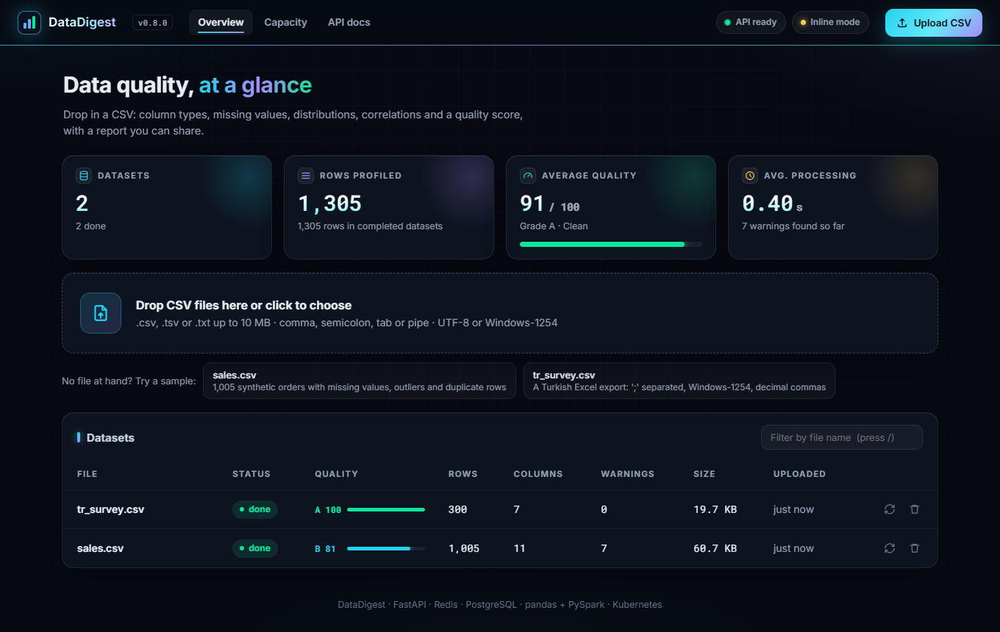
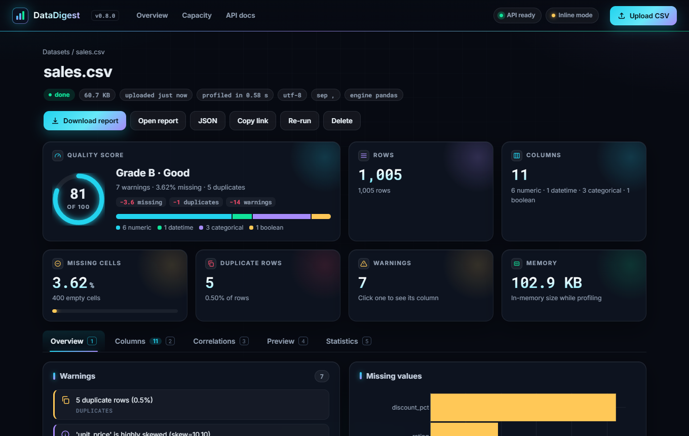
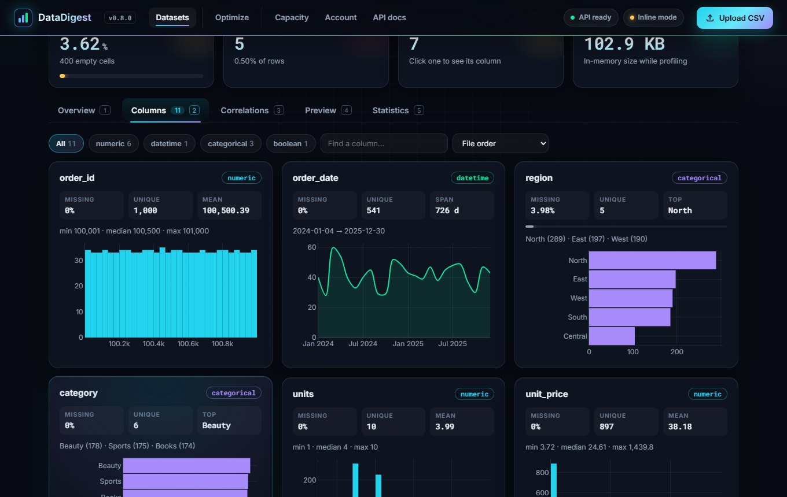
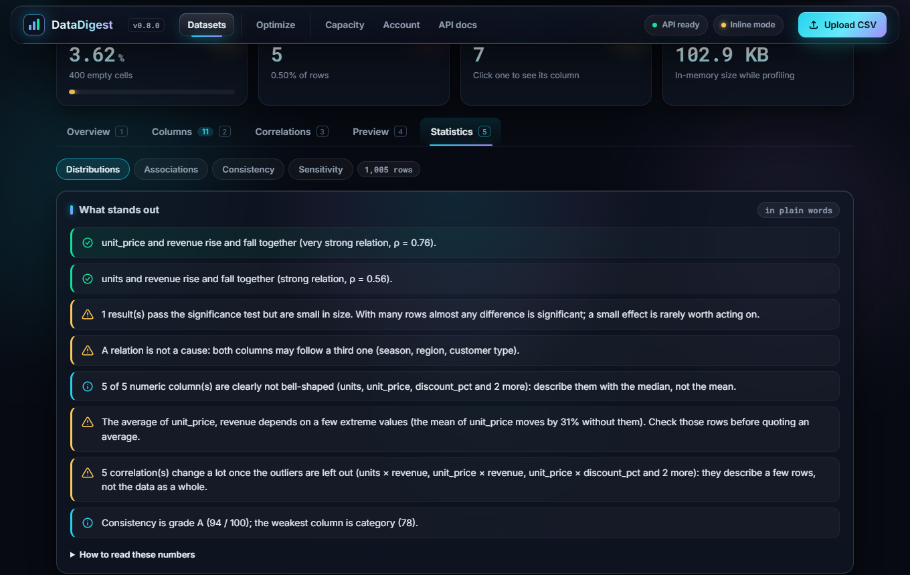
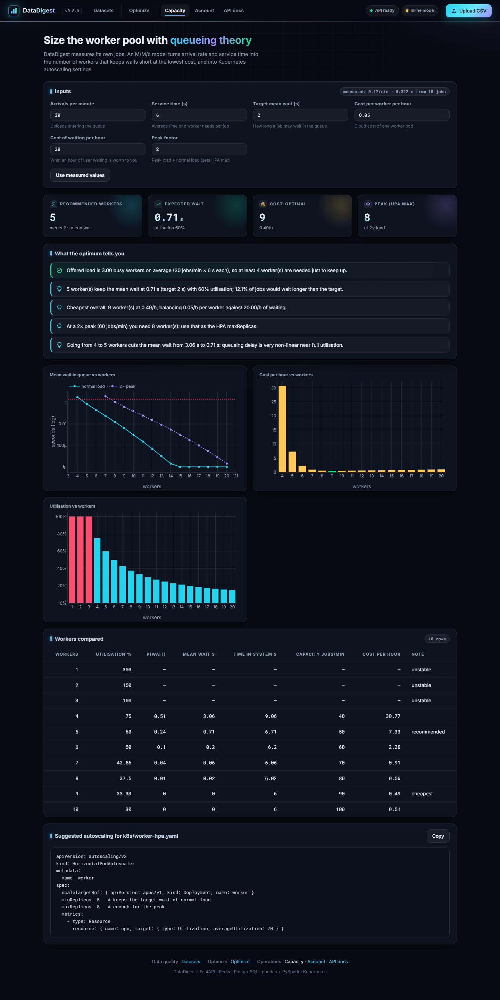
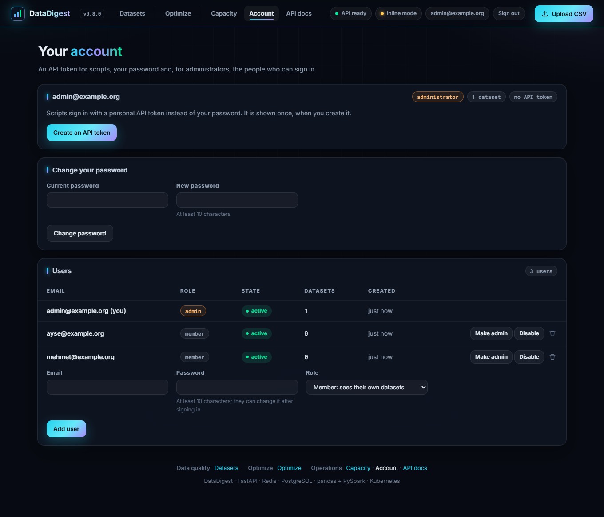
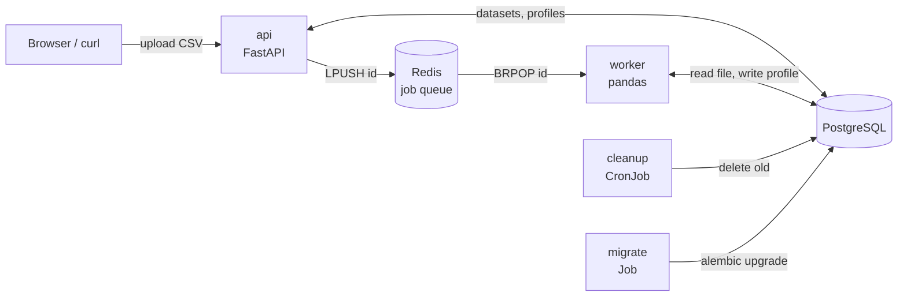

# DataDigest

[](https://github.com/Obejarl/datadigest/actions/workflows/ci.yml)


**DataDigest tells you whether a CSV can be trusted before you build on it.** Upload a file and get
a 0-100 quality score, the problems behind the score (missing values, duplicates, outliers,
inconsistent labels), a statistics summary in plain words, and a report you can share.

It reads the files people actually have: an Excel export from a Turkish locale (`;` separated,
Windows-1254, decimal commas, `dd.mm.yyyy` dates) works without any option. Files too big for one
process's memory are profiled by **Apache Spark (PySpark)** with identical output, on one machine
or on a cluster.

```bash
pip install -r requirements.txt
python -m datadigest          # http://127.0.0.1:8000: no Docker, Redis or PostgreSQL needed
```

That one process is enough for one person. The same code also runs as a small production service:
a REST API, background workers behind a Redis queue, PostgreSQL, user accounts, Prometheus and
Grafana, Docker Compose and Kubernetes manifests, and CI that tests all of it against real services.









## What it does

- **Reads messy real-world CSVs.** It detects the encoding (UTF-8, Windows-1254, Latin-1)
  and the delimiter (`,` `;` tab `|`), and understands decimal commas and `dd.mm.yyyy`
  dates, so an Excel export from a Turkish locale works without extra options.
- **Profiles every column.** It infers each column's type (numeric, categorical, datetime,
  boolean or text) and computes stats, histograms, top values, timelines and a Pearson
  correlation matrix.
- **Flags data-quality problems.** These include duplicate rows, heavily missing columns,
  constant columns, likely ID columns, skewed distributions, outliers (IQR rule) and highly
  correlated pairs.
- **Scores data quality.** Every file gets a 0-100 quality score with an A-D grade, built
  from missing cells, duplicates and weighted warnings
  ([`quality_score`](datadigest/core/profile.py)). The breakdown is shown next to the
  score, so the number explains itself.
- **Reports.** You get an interactive dashboard and a single-file HTML report. Both are
  drawn from the same Plotly specs. The dashboard has tabs for overview, column cards
  (filter by type, sort by missing or unique values), correlations and a preview of the
  first rows. Warnings link to their column. Tab links are shareable (`#columns`), and
  the `1`-`5` keys switch tabs. Motion is light and optional: a sliding tab indicator, a
  cursor spotlight on cards, staggered entrances and animated page changes, all switched off
  by `prefers-reduced-motion`.
- **Says what stands out, in plain words.** A Statistics tab (and report section) opens with a
  short summary: the relations that are both significant and large, and the results that are easy
  to misread. Behind it are variance, CV, confidence intervals, normality tests,
  Kolmogorov-Smirnov distribution fits, five kinds of association tests, degrees of consistency
  and sensitivity analyses (see [Statistics](#statistics)).
- **Scales past pandas.** Files that do not fit in one process's memory are profiled by
  [Apache Spark](https://spark.apache.org/) instead, with the same output (see
  [Big files with Spark](#big-files-with-spark)).
- **Keeps people's data apart.** With accounts switched on, everyone signs in and sees only the
  datasets they uploaded; administrators see all of them and manage the users (see
  [Access control](#access-control)).
- **Friendly to first-time visitors.** One-click sample datasets, multi-file upload with
  progress, re-run and delete from the list, and keyboard access throughout.
- **Recovers from crashes.** If a worker dies mid-job, the cleanup CronJob marks the job
  failed after 15 minutes and the UI offers "Try again" instead of spinning forever.

## Capacity planning
### Capacity planning for DataDigest itself



How many workers does a deployment need? The `/capacity` page applies queueing theory
(M/M/c, Erlang C) to DataDigest's own workers. Arrival rate and service time are measured from completed jobs, or you can
enter a scenario (shareable as a link). It reports:

- the fewest workers that meet a target mean wait;
- the cost-optimal count (worker cost against waiting cost);
- the count needed at peak load;
- ready-to-paste `minReplicas`/`maxReplicas` for the worker HPA.

> The operations-research solvers that used to live here (production planning, transportation,
> assignment, budget allocation) are now their own project, OptiDesk, so that each tool does one
> thing. DataDigest checks the data; OptiDesk decides with it.

## Statistics

Every profile also carries an `advanced` section ([`core/stats/`](datadigest/core/stats/__init__.py)),
shown on the dashboard's **Statistics** tab (key `5`) and in the HTML report. It is computed on at most
`STATS_MAX_ROWS` rows (50,000 by default; a seeded random sample for bigger files, and the tab says so),
by both the pandas and the Spark engine.

**Plain words first.** Dozens of test results invite one mistake: reading every small p-value as a
finding. So the tab opens with *What stands out*
([`highlights.py`](datadigest/core/stats/highlights.py)): a few sentences such as "unit_price and
revenue rise and fall together (very strong relation)", followed by the traps, such as "1 result
passes the significance test but is small in size" or "the mean of unit_price moves by 31% without a
few extreme values". A relation that is reported always comes with the reminder that it is not a
cause. In the tables a significant result is green only when its effect is not small; a significant
but tiny one is amber. A *How to read these numbers* box says how many tests were run and how many
would look significant by chance.

| Section | What it gives you |
|---|---|
| **Distributions** | Mean, median, mode, **variance**, standard deviation, **coefficient of variation**, standard error and 95% CI of the mean, skewness, excess kurtosis, percentiles (1/5/95/99), IQR, **MAD**, trimmed mean; **Shapiro-Wilk, D'Agostino and Jarque-Bera** normality tests (rejected only when they agree); **Kolmogorov-Smirnov fits** against normal, log-normal, exponential, uniform, gamma and Weibull with the closest one named |
| **Numeric associations** | Pearson, Spearman and Kendall for column pairs, a hint when they disagree (non-linear or driven by outliers) |
| **Categorical associations** | **Chi-square test of independence**, bias-corrected **Cramér's V**, contingency coefficient, and a warning when expected counts are too small for the test |
| **Ordinal associations** | **Goodman-Kruskal gamma**, Kendall tau-b and **Somers' d** (both directions) for rating-like columns and quintile-cut continuous ones |
| **Numeric by group** | One-way **ANOVA**, **Kruskal-Wallis**, Levene/Brown-Forsythe variance test and **eta squared**; for two groups also Welch t, Mann-Whitney U, **Cohen's d, Hedges' g and Cliff's delta** |
| **Consistency** | Per column completeness, validity (parses as its type), uniqueness, format consistency (dominant character pattern), label variants (`Istanbul` / `istanbul `), conflicting duplicate keys, an overall degree with a grade, and **Cronbach's alpha** with item-total correlations |
| **Sensitivity** | How the mean, median and standard deviation move when IQR outliers are dropped, winsorized and trimmed means, **bootstrap confidence intervals** (300 resamples), and which correlations change a lot or flip sign without the extreme rows |

Two more guard rails are built in. Dozens of tests run at once, so every p-value comes with a
**Benjamini-Hochberg adjusted** value (`p_adj`). With many rows almost any difference is "significant", so
each test is paired with an effect size (V, eta squared, d, delta, gamma) and a plain-word label. Identifier
columns (unique integers) are left out of the association tests, and the Kolmogorov-Smirnov p-values are
labelled optimistic because the parameters are fitted on the same data. Tests are checked against
independent calculations (brute-force Cliff's delta, a textbook FDR example, planted relationships).

## Big files with Spark

pandas loads a whole file into one process's memory. For files that do not fit, the same
profile can be computed by Apache Spark, which reads the file in partitions and runs every
statistic as a distributed aggregation. The result is the **same JSON**, so the dashboard,
charts, quality score and HTML report work unchanged
([`spark_profile.py`](datadigest/core/spark_profile.py)).

```bash
pip install -r requirements-spark.txt          # pyspark; also needs a Java 17+ runtime
python -m datadigest.cli report big.csv --engine spark
python -m datadigest.cli report facts.parquet  # Parquet always uses Spark
```

**In the app.** Uploads stop at 10 MB because they are stored in the database. A bigger file goes
into a folder on the server instead (`LARGE_DATA_DIR`, for example a mounted volume) and is
registered by name; the dashboard lists such files under the samples, and the worker reads them
from disk:

```bash
LARGE_DATA_DIR=/data REDIS_URL=redis://localhost:6379/0 python -m datadigest.worker
curl -X POST http://localhost:8000/api/server-files/orders-2026.csv      # 202, then poll the dataset
```

The engine is picked per file (`auto`): Spark for Parquet and for files of at least `SPARK_MIN_MB`
(default 100), pandas otherwise or when Spark is not installed. `docker build --target spark .` builds
an image with Java and pyspark for those workers; releases publish it as `ghcr.io/obejarl/datadigest:spark`.

**On a cluster.** By default Spark runs inside the worker process (`SPARK_MASTER=local[*]`). Point it
at a cluster and the worker becomes the Spark *driver*: it plans the job and collects the small
results, while executors on other machines read the file and do the aggregation.

| Setting | Meaning |
|---|---|
| `SPARK_MASTER` | `local[*]`, or a cluster address such as `spark://spark-master:7077` |
| `SPARK_DRIVER_HOST` | The address executors use to call back to the worker (in Kubernetes: the pod IP) |
| `SPARK_EXECUTOR_MEMORY`, `SPARK_DRIVER_MEMORY` | Heap sizes, for example `1g` |
| `SPARK_CONF` | Any other Spark settings: `spark.cores.max=2,spark.executor.cores=2` |

Executors open the file themselves, so `LARGE_DATA_DIR` must be shared storage mounted at the same
path on the worker and on every executor. [`deploy/k8s-spark/`](deploy/k8s-spark/kustomization.yaml)
is a ready-made Kubernetes setup: the base manifests plus a Spark standalone cluster (one master,
two workers), a shared volume, and DataDigest workers that submit to it:

```bash
docker build --target spark -t datadigest-spark:0.8.0 .
kubectl apply -k deploy/k8s-spark/
kubectl -n datadigest port-forward svc/spark-master 8080     # the cluster's own status page
```

CI deploys exactly this to a kind cluster, puts a 200,000-row file on the volume, profiles it through
the API and checks with the Spark master that the application ran on its executors.

**Is it the same?** A test runs both engines on the sample files and on a deliberately messy one
(missing values, duplicate rows and headers, a Windows-1254 file with decimal commas, a byte-order
mark, bad dates) and compares the whole profile. Known, deliberate differences: above 5 million rows
quantiles are approximate (the exact algorithm keeps every distinct value in memory); a row with the
wrong number of fields is padded instead of failing the file; line breaks inside quoted fields are not
supported (they would stop Spark from splitting the file); the "memory" figure is the size on disk.

**Is it faster?** No, and it is not meant to be. Spark pays for starting a JVM and for shuffling data
between partitions, so on one machine pandas wins as long as the file fits in memory:

| Rows | File | Engine | Profile time | Wall time (incl. start-up) | Peak memory |
|---:|---:|---|---:|---:|---:|
| 100,000 | 5 MB | pandas | 0.2 s | 0.9 s | 139 MB |
| 100,000 | 5 MB | spark | 26.6 s | 27.5 s | 1,431 MB |
| 1,000,000 | 47 MB | pandas | 2.3 s | 3.0 s | 454 MB |
| 1,000,000 | 47 MB | spark | 42.1 s | 43.2 s | 2,712 MB |
| 5,000,000 | 241 MB | pandas | 10.8 s | 11.6 s | 1,913 MB |
| 5,000,000 | 241 MB | spark | 84.0 s | 85.0 s | 4,847 MB |
| 20,000,000 | 979 MB | pandas | 44.0 s | 44.7 s | 7,510 MB |
| 20,000,000 | 979 MB | spark | 226.9 s | 227.9 s | 5,060 MB |

(Windows 11, 24 threads, 32 GB RAM, Spark in local mode with a 4 GB driver, 8 columns of synthetic
sales data. Peak memory counts the whole process tree, so it includes Spark's JVM.)

What it shows: pandas is faster at every size tested, because Spark pays for starting a JVM and for
shuffling data between partitions. The picture changes only in memory. pandas grows with the file
(about 375 MB per million rows here, so roughly 37 GB for 100 million rows, more than this machine
has), while Spark stays near its driver size and keeps working. At 20 million rows they are already
in the same range (7.5 GB against 5.1 GB). Spark's real advantage is a cluster, where the partitions
are spread over many machines; in local mode it only helps with files that do not fit in RAM. The
table was measured in local mode; no multi-machine benchmark has been run yet.

This is why `auto` keeps small files on pandas. Reproduce the table with `python scripts/benchmark_engines.py 1000000 5000000`.

## Reliability and observability

**Jobs are not lost when a worker dies.** The queue
([`jobqueue.py`](datadigest/jobqueue.py)) gives *at-least-once* delivery, the same
contract as RQ, Celery or SQS:

1. A worker takes a job with one atomic `BLMOVE` from the queue to a *processing* list.
2. The worker acks the job only after its handler returns.
3. If the worker crashes, the job stays in *processing*. Housekeeping moves it back to the
   queue after `JOB_VISIBILITY_SECONDS`.
4. After `MAX_JOB_ATTEMPTS` the job goes to a *dead-letter* list, and the dataset is marked
   failed.

Handlers are idempotent (re-running overwrites the result), which at-least-once
requires. Workers also wait out Redis or PostgreSQL outages with exponential backoff
instead of crash-looping.

**Everything is measured.** The API serves Prometheus metrics at `/metrics`, and each
worker serves its own on port 9100:
- request rate and latency per route template;
- job duration, queue wait and outcome per job kind;
- queue depth (pending, in flight, dead);
- retries, dead letters, crashes and backoffs.

`docker compose --profile monitoring up` adds Prometheus (`:9090`) and Grafana (`:3000`).
Grafana comes with a provisioned **DataDigest** dashboard (10 panels, generated by
[`deploy/grafana/make_dashboard.py`](deploy/grafana/make_dashboard.py)). In Kubernetes,
the pods carry `prometheus.io/*` annotations.

Nine **alert rules** ([`deploy/prometheus/alerts.yml`](deploy/prometheus/alerts.yml)) watch for a
dead API or worker, dead-letter jobs, a queue backlog, jobs stuck in flight, handler crashes, high
queue wait or API latency, and a rising 5xx rate. Each one is unit-tested with `promtool` against
synthetic metrics. Prometheus shows firing alerts on `:9090/alerts`; add Alertmanager to be notified.

CI proves all of this on every push:
- **Compose job:** Prometheus scrapes the API and both workers and counts the finished
  jobs, loads the alert rules, and Grafana's data source and dashboard are checked.
- **Kubernetes job:** it scales the workers to zero, abandons a job the way a crashing
  worker would, starts a fresh worker, and checks that the job is requeued and finished.

## Access control

Off by default, so local use and the demos need no login. There are two ways to switch it on.

**Accounts (`AUTH_MODE=accounts`).** People sign in with an email and a password. A *member* sees
only the datasets they uploaded: someone else's dataset answers `404`, exactly like an id that does
not exist. An *administrator* sees every dataset and manages the users on the `/account` page.

```bash
AUTH_MODE=accounts
SECRET_KEY=<a long random string>      # signs the session cookies; the same on every API replica
ADMIN_EMAIL=you@example.org            # the first administrator, created at startup
ADMIN_PASSWORD=<at least 10 characters>
```



Further users are added on the `/account` page or with
`python -m datadigest.accounts add ada@example.org [--admin]`. How it is built
([`accounts.py`](datadigest/accounts.py), [`auth.py`](datadigest/api/auth.py)):

- passwords are stored as salted scrypt hashes;
- the session cookie is a signed user id with an expiry (HttpOnly, SameSite=Lax), so the server
  keeps no session table. The account is still looked up on every request, so disabling or
  deleting a user locks them out at once, not when the cookie expires;
- scripts use a personal API token (`Authorization: Bearer dd_...`), created on the `/account`
  page, shown once and stored only as a hash;
- a wrong password and an unknown email give the same answer in the same time, and both are
  throttled (5 per minute per address);
- deleting a user deletes their datasets; an administrator cannot demote, disable or delete
  their own account, so there is always one left.

**One shared token (`ACCESS_TOKEN`).** Simpler, for a team that shares everything:

```bash
python -c "import secrets; print(secrets.token_urlsafe(32))"   # make a long random token
echo ACCESS_TOKEN=<the token> >> .env                          # local; Compose reads it too
```

Every page and API call then needs the token: the sign-in page turns it into a session cookie (an
HMAC of the token, never the token), and scripts send `Authorization: Bearer <token>`.

In both modes `/healthz`, `/readyz`, `/metrics` (counts and route names, no data), the login page
and static files stay open so probes and Prometheus keep working. In Kubernetes the settings go
into `k8s/secret.yaml`. See [SECURITY.md](SECURITY.md).

## Backups and restores

- **Redis** writes an append-only file to a volume (Compose volume, Kubernetes PVC).
- **PostgreSQL** is dumped nightly by the `postgres-backup` CronJob into its own volume. Each
  dump is read back (`pg_restore --list`) before old ones (older than 7 days) are deleted.

Take one on demand and prove it restores (the second Job restores into a scratch database and
never touches the live one):

```bash
kubectl -n datadigest create job --from=cronjob/postgres-backup backup-now
kubectl -n datadigest apply -f k8s/ops/restore-check-job.yaml
kubectl -n datadigest logs job/restore-check          # prints how many datasets came back
```

To restore for real, scale the API and workers to zero, then
`pg_restore --clean --if-exists --no-owner --dbname=datadigest <dump>` from a pod that mounts
the `postgres-backups` volume. With Compose:

```bash
docker compose exec -T postgres pg_dump -U datadigest -Fc datadigest > backup.dump
docker compose exec -T postgres pg_restore -U datadigest --clean --if-exists -d datadigest < backup.dump
```

## Architecture



1. `POST /api/datasets` stores the job and returns **202 Accepted** right away. Queue entries
   carry their kind (`dataset:<id>`).
2. A worker takes the job from Redis, profiles the file, and writes the result as JSONB to
   PostgreSQL.
3. The client polls `GET /api/datasets/{id}` until the status is `done`.

The API answers quickly no matter how big the file is, and workers scale on their own.
Without `REDIS_URL` the API processes uploads itself (inline mode), so local development
needs no extra services.

One Docker image runs every role:

| Role | Command |
|---|---|
| api | `uvicorn datadigest.api.main:app` (default) |
| everything in one process | `python -m datadigest` (migrates, then serves; SQLite, inline mode) |
| worker | `python -m datadigest.worker` |
| migrate | `alembic upgrade head` |
| cleanup | `python -m datadigest.cleanup` |

## API

| Method | Path | |
|---|---|---|
| `POST` | `/api/datasets` | Upload (multipart `file`). `202` on success; `413` over the size limit, `415` wrong type |
| `GET` | `/api/datasets` | Recent datasets (no file contents) |
| `GET` | `/api/datasets/{id}` | Status and summary |
| `GET` | `/api/datasets/{id}/profile` | Full profile JSON (`409` until done) |
| `GET` | `/api/datasets/{id}/charts` | Plotly figure specs |
| `GET` | `/api/datasets/{id}/report` | HTML report (`?download=true` to save) |
| `POST` | `/api/datasets/{id}/reprocess` | Run the analysis again (`409` while queued/processing) |
| `DELETE` | `/api/datasets/{id}` | Delete dataset and file |
| `GET` | `/api/capacity` | M/M/c worker sizing; missing inputs come from measured job history |
| `GET` | `/api/server-files` | Files in `LARGE_DATA_DIR` that can be registered (`enabled: false` when unset) |
| `POST` | `/api/server-files/{name}` | Profile a file from `LARGE_DATA_DIR` (`202`; `404` for names that are not plain files in that folder) |
| `GET` | `/api/samples` | Bundled demo files |
| `POST` | `/api/samples/{name}` | Create a dataset from a demo file |
| `GET` | `/api/stats` | Totals for the dashboard: datasets by status, rows, average quality and processing time, mode, queue depth |
| `POST` | `/api/login`, `/api/logout` | Sign in (`{token}` or `{email, password}`) and out |
| `GET` | `/api/auth/status` | Whether a sign-in is required, the mode, and who you are |
| `GET` | `/api/me` | Your account (accounts mode) |
| `POST`, `DELETE` | `/api/me/token` | Create (or replace) and revoke your API token |
| `POST` | `/api/me/password` | Change your password |
| `GET`, `POST` | `/api/users` | Administrators: list and create users |
| `PATCH`, `DELETE` | `/api/users/{id}` | Administrators: change role, disable, reset password, delete |
| `GET` | `/healthz`, `/readyz` | Liveness / readiness |
| `GET` | `/metrics` | Prometheus metrics (requests, jobs, queue, datasets) |

Interactive docs: `http://localhost:8000/docs`

## Running it

### 0. Windows: one double-click

`DataDigest.bat` installs the Python environment, starts the app and opens the dashboard.
It also has a menu for Docker, demo data, health checks, tests and stopping
(`DataDigest.bat start|docker|monitoring|demo|health|test|stop`).

### 1. One command (no Docker, no Redis, no PostgreSQL)

```bash
python -m venv .venv && .venv\Scripts\activate      # Linux/macOS: source .venv/bin/activate
pip install -r requirements.txt
python -m datadigest
```

Open http://127.0.0.1:8000 and drop `samples/sales.csv` on the page. The database is a SQLite file
in the folder, and the API profiles uploads itself. This is the right setup for one person; the
next ones add what a team needs.

### 2. CLI only

```bash
python -m datadigest.cli report samples/tr_survey.csv -o report.html
```

### 2b. For development

```bash
pip install -r requirements-dev.txt
alembic upgrade head
uvicorn datadigest.api.main:app --reload
```

### 3. Docker Compose (PostgreSQL + Redis + 2 workers)

```bash
docker compose up --build
```

### 4. Kubernetes (Docker Desktop, kind or minikube)

```bash
docker build -t datadigest:0.8.0 .
# kind: kind load docker-image datadigest:0.8.0   minikube: minikube image load datadigest:0.8.0
cp k8s/secret.example.yaml k8s/secret.yaml           # then change the password
kubectl apply -k k8s/
kubectl -n datadigest get pods -w
kubectl -n datadigest port-forward svc/api 8000:80
```

The worker HPA needs `metrics-server`, which Docker Desktop does not ship. Install it with:

```bash
kubectl apply -f https://github.com/kubernetes-sigs/metrics-server/releases/latest/download/components.yaml
```

On Docker Desktop, also add `--kubelet-insecure-tls` to its container args.

## Tests and CI

```bash
ruff check . && ruff format --check .
pytest --cov=datadigest --cov-fail-under=90    # unit tests: SQLite + fakeredis (coverage ~95%)
python scripts/check_manifests.py              # cross-checks selectors, ports, refs, env vars
pip install -r requirements-spark.txt          # optional, needs Java 17+
pytest -m spark                                # the Spark engine must match pandas
pip install -r requirements-e2e.txt && playwright install chromium
pytest tests_e2e                               # browser tests (E2E_BROWSER_CHANNEL=msedge uses Edge)
```

`scripts/smoke_test.sh <url>` checks a running deployment end to end. It waits for
`/readyz`, queues six profiles of the bundled samples at once, waits for each and calls the
capacity planner (set `ACCESS_TOKEN` if the server requires one).

GitHub Actions runs eight jobs on every push:
- **test:** lint, unit tests with a 90% coverage gate, manifest checks and `kubeconform`
  schema validation;
- **spark:** the Spark engine against pandas (coverage gate on the Spark module), plus a
  benchmark run;
- **integration:** tests against real PostgreSQL and Redis service containers, including a
  migration up/down/up;
- **browser:** [Playwright](https://playwright.dev/) drives a real browser through the dashboard:
  uploading files, tabs and keyboard shortcuts, the delete dialog, the statistics summary, the
  capacity page, phone-width layout including charts, the token sign-in, and accounts (an
  administrator adds a member, who sees only their own datasets and is locked out when disabled);
- **docker:** a Docker build, then that smoke test against the running container (which
  proves the statistics stack and the sample files are in the image), and a build of the Spark
  variant that profiles a sample with Spark inside it;
- **compose:** the full `docker compose` stack (PostgreSQL, Redis, migration, API, two
  workers, Prometheus, Grafana) and these checks:
  - the smoke test through the queue, and both workers processed jobs;
  - `promtool` validates the alert rules and unit-tests that each alert fires;
  - Prometheus scrapes three targets, loaded the rules, and nothing fires on a healthy system;
  - jobs queued while no worker runs survive a Redis restart;
- **kubernetes:** a real cluster with [kind](https://kind.sigs.k8s.io/), then
  `kubectl apply -k k8s/` and these checks:
  - the StatefulSet, the migration Job and the Deployments become ready, with no crash
    loops;
  - the smoke test passes through the Service;
  - a job abandoned by a dead worker is requeued and finished;
  - queued jobs survive a Redis pod replacement;
  - a database backup is taken and restored into a scratch database;
  - the cleanup CronJob runs once;
  - after the API and database pods are deleted, the data is still there;
- **spark-cluster:** a second kind cluster with `kubectl apply -k deploy/k8s-spark/`: both Spark
  workers register with the master, a 200,000-row file on the shared volume is profiled through
  the API with `engine: spark`, and the master reports the application on its executors.

Pushing a tag such as `v0.8.0` runs the **release** workflow: it checks that the tag matches
the version in the code and in `CHANGELOG.md`, smoke-tests the image (and the Spark variant),
pushes them to `ghcr.io/obejarl/datadigest`, and creates the GitHub Release from the changelog.

## Design decisions

- **Own queue on a Redis list instead of Celery/RQ.** The whole mechanism is three small
  functions in [`jobqueue.py`](datadigest/jobqueue.py), and it runs on Windows (RQ needs `fork`).
- **Raw files in PostgreSQL (`bytea`, 10 MB limit).** The API and the workers then share
  no disk, so no ReadWriteMany volume is needed. Object storage would be the next step
  (see roadmap).
- **Spark is optional and picked by size.** pyspark and a JVM are heavy, so they live in
  `requirements-spark.txt` and a separate Docker target; the core never imports them. Big files
  bypass the database and are read by name from `LARGE_DATA_DIR`, with the name checked so it
  cannot point outside that folder.
- **Accounts without a session table or a new dependency.** scrypt from the standard library,
  a signed cookie, and one indexed lookup per request. Ownership is one nullable column and one
  query filter ([`visible`](datadigest/api/auth.py)) used by every dataset route, so a route
  cannot forget it without failing the isolation tests.
- **One profile, two renderers.** The profile is plain JSON, and the dashboard and report
  both render it with the same Plotly specs, so they never disagree.
- **Liveness ≠ readiness.** `/healthz` checks nothing external, so a database outage does
  not make Kubernetes restart every pod. `/readyz` checks PostgreSQL and Redis and takes
  the pod out of the load balancer instead.
- **Migrations as a Job.** Running Alembic in every API replica would race on startup.
- **Security.** Responses carry `nosniff`, `X-Frame-Options: DENY` and a same-origin
  referrer policy. Column names come from user files, so the report is autoescaped and the
  dashboard only writes with `textContent`. Uploads are size-limited while they stream in.
  Containers run as non-root. No real credentials are in git.

## Limitations

- Retries are at least once, so a job can run twice (for example if a worker dies after
  saving the result but before the ack). That is harmless because the handlers are
  idempotent, but it would matter for side effects such as sending e-mails.
- Redis keeps its data with an append-only file synced every second, so a hard crash can
  lose about one second of new jobs. The cleanup CronJob still fails anything left
  `processing` for `STUCK_AFTER_MINUTES`, as a last resort.
- The pandas engine loads the file into memory, so it is capped at 200k rows (`MAX_ROWS`); the
  Spark engine has no row cap.
- A Spark job can outlast the queue's visibility timeout (`JOB_VISIBILITY_SECONDS`, 120 s by
  default), and the queue would then hand the same file to a second worker. Raise it for workers
  that profile big files.
- The Spark cluster setup is a standalone cluster checked on a single-node kind cluster. A
  multi-node cluster needs ReadWriteMany storage for the shared volume, and each DataDigest
  worker keeps its executors (2 cores) for as long as it runs. On Windows, Spark cannot start
  from a folder whose path has non-ASCII characters (the error says so).
- Accounts are deliberately small: no self-service sign-up, no password reset by email, no
  single sign-on, and datasets cannot be shared between members. Without `AUTH_MODE` or
  `ACCESS_TOKEN`, anyone who can reach the API sees everything. Compose therefore publishes its
  ports on `127.0.0.1` only, and Grafana's `admin/admin` login and anonymous viewer are for
  local demos. Behind a TLS-terminating proxy, run uvicorn with `--proxy-headers` so the
  session cookie is marked `Secure`.
- The statistics explore; they do not prove. The summary names what stands out, but it cannot
  know which relations matter in your domain.
- Backups are logical dumps kept on a volume next to the database, so they protect against
  mistakes and corruption, not against losing the cluster. Copy them off-cluster for that.
- The capacity planner assumes M/M/c (random arrivals, exponential service). It says
  so when the measured service times vary more or less than that.

## Roadmap

- [ ] S3/MinIO for uploads instead of `bytea`
- [x] Per-user accounts instead of one shared token
- [ ] Sharing a dataset with another member; single sign-on
- [ ] Alertmanager (the alert rules exist; notifications do not)
- [x] Spark on a cluster (Kubernetes) instead of local mode
- [ ] A multi-machine Spark benchmark; executors that scale with the load
- [ ] A hosted live demo

## Project layout

```
datadigest/core/      pure profiling: loader, profile (pandas), spark_profile, engines, charts, report (no DB, no HTTP)
datadigest/core/stats/  the Statistics tab: distributions, associations, consistency, sensitivity, highlights
datadigest/api/       FastAPI routes, auth, schemas, dependencies
datadigest/static/    dashboard (plain HTML/CSS + one script per page: core, index, dataset, stats, capacity, account, login)
datadigest/*.py       config, db, models, accounts, jobs, queue, worker, cleanup, capacity (M/M/c), serverfiles, CLI
scripts/              smoke test, manifest checks, engine benchmark
migrations/           Alembic
k8s/                  Kubernetes manifests (kustomize)
deploy/k8s-spark/     the same plus a Spark cluster; deploy/ also holds Prometheus and Grafana
tests/                unit + integration tests
tests_e2e/            browser tests (Playwright)
docs/LEARNING.md      concept guide (Turkish)
```

## License

MIT
