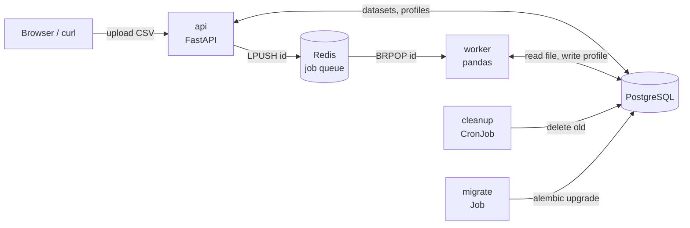

# DataDigest

[](https://github.com/Obejarl/datadigest/actions/workflows/ci.yml)


Upload a CSV and get an automatic data-quality profile: column types, missing values,
distributions, correlations, warnings and a shareable HTML report. Then **optimise** on the
same data with operations research: production plans, shipping routes, team assignments
and budgets, solved to the proven optimum and explained in plain words.

Built as a small but complete service: a REST API, a background worker behind a Redis
queue, PostgreSQL, Docker Compose, Kubernetes manifests (with autoscaling and a CronJob)
and CI that tests against real databases.


## What it does

- **Reads messy real-world CSVs.** It detects the encoding (UTF-8, Windows-1254, Latin-1)
  and the delimiter (`,` `;` tab `|`), and understands decimal commas and `dd.mm.yyyy`
  dates, so an Excel export from a Turkish locale works without extra options.
- **Profiles every column.** It infers each column's type (numeric, categorical, datetime,
  boolean or text) and computes stats, histograms, top values, timelines and a Pearson
  correlation matrix.
- **Flags data-quality problems.** These include duplicate rows, heavily missing columns,
  constant columns, likely ID columns, skewed distributions, outliers (IQR rule) and highly
  correlated pairs.
- **Scores data quality.** Every file gets a 0-100 quality score with an A-D grade, built
  from missing cells, duplicates and weighted warnings
  ([`quality_score`](datadigest/core/profile.py)). The breakdown is shown next to the
  score, so the number explains itself.
- **Reports.** You get an interactive dashboard and a single-file HTML report. Both are
  drawn from the same Plotly specs. The dashboard has tabs for overview, column cards
  (filter by type, sort by missing or unique values), correlations and a preview of the
  first rows. Warnings link to their column. Tab links are shareable (`#columns`), and
  the `1`-`4` keys switch tabs.
- **Friendly to first-time visitors.** One-click sample datasets, multi-file upload with
  progress, re-run and delete from the list, and keyboard access throughout.
- **Recovers from crashes.** If a worker dies mid-job, the cleanup CronJob marks the job
  failed after 15 minutes and the UI offers "Try again" instead of spinning forever.

## Operations research


Pick a problem type, run the bundled example in one click, or point it at your own
dataset (the form is built from the file's columns). Solvers run on the same queue and
workers as profiling.

| Problem | Decides | Method | Output beyond the plan |
|---|---|---|---|
| **Production planning** | How much of each product to make for maximum profit under machine, labour and material limits | LP / MIP with HiGHS | Shadow price of every resource, opportunity cost of products left out, integrality gap, what-if curve on the bottleneck |
| **Transportation** | Who ships how much to whom at minimum cost | LP with HiGHS | Value of +1 supply per source, cost of +1 demand per destination, Sankey of flows |
| **Assignment** | One-to-one pairing of people and tasks for the best team total | Hungarian algorithm | Who gives up their personal best task, and by how much |
| **Budget allocation** | Which projects to fund under several budgets | 0/1 MIP with HiGHS | LP upper bound and gap; which projects the optimum swaps versus the ranking rule |

Every result is compared with the rule of thumb people actually use (highest margin
first, cheapest route first, best pair first, best value-per-cost first). On the bundled
examples the optimum is **23%, 5%, 6% and 13% better**.

The numbers are verified, not just plausible: tests check each optimum against brute
force, and each shadow price or dual against re-solving with one more unit.


### Capacity planning for DataDigest itself


The `/capacity` page applies queueing theory (M/M/c, Erlang C) to DataDigest's own
workers. Arrival rate and service time are measured from completed jobs, or you can
enter a scenario (shareable as a link). It reports:

- the fewest workers that meet a target mean wait;
- the cost-optimal count (worker cost against waiting cost);
- the count needed at peak load;
- ready-to-paste `minReplicas`/`maxReplicas` for the worker HPA.

## Architecture



1. `POST /api/datasets` (or `POST /api/optimizations`) stores the job and returns **202 Accepted**
   right away. Queue entries carry their kind (`dataset:<id>`, `optimization:<id>`).
2. A worker takes the job from Redis, profiles the file or runs the solver, and writes the
   result as JSONB to PostgreSQL.
3. The client polls `GET /api/datasets/{id}` until the status is `done`.

The API answers quickly no matter how big the file is, and workers scale on their own.
Without `REDIS_URL` the API processes uploads itself (inline mode), so local development
needs no extra services.

One Docker image runs every role:

| Role | Command |
|---|---|
| api | `uvicorn datadigest.api.main:app` (default) |
| worker | `python -m datadigest.worker` |
| migrate | `alembic upgrade head` |
| cleanup | `python -m datadigest.cleanup` |

## API

| Method | Path | |
|---|---|---|
| `POST` | `/api/datasets` | Upload (multipart `file`). `202` on success; `413` over the size limit, `415` wrong type |
| `GET` | `/api/datasets` | Recent datasets (no file contents) |
| `GET` | `/api/datasets/{id}` | Status and summary |
| `GET` | `/api/datasets/{id}/profile` | Full profile JSON (`409` until done) |
| `GET` | `/api/datasets/{id}/charts` | Plotly figure specs |
| `GET` | `/api/datasets/{id}/report` | HTML report (`?download=true` to save) |
| `POST` | `/api/datasets/{id}/reprocess` | Run the analysis again (`409` while queued/processing) |
| `DELETE` | `/api/datasets/{id}` | Delete dataset and file |
| `GET` | `/api/optimize/kinds` | Problem types, parameter schemas and examples |
| `POST` | `/api/optimizations` | Run a solver on a dataset: `{dataset_id, kind, params}` (`202`, `422` on bad params or unknown columns) |
| `POST` | `/api/optimize/examples/{kind}` | Load the example data and solve it in one call |
| `GET` | `/api/optimizations`, `/api/optimizations/{id}` | Runs, and one run with its full result |
| `GET` | `/api/optimizations/{id}/report` | Optimization report as HTML |
| `GET` | `/api/capacity` | M/M/c worker sizing; missing inputs come from measured job history |
| `GET` | `/api/samples` | Bundled demo files |
| `POST` | `/api/samples/{name}` | Create a dataset from a demo file |
| `GET` | `/api/stats` | Totals for the dashboard: datasets by status, rows, average quality and processing time, mode, queue depth |
| `GET` | `/healthz`, `/readyz` | Liveness / readiness |

Interactive docs: `http://localhost:8000/docs`

## Running it

### 1. CLI only (no services)

```bash
python -m venv .venv && .venv\Scripts\activate      # Linux/macOS: source .venv/bin/activate
pip install -r requirements-dev.txt
python -m datadigest.cli report samples/tr_survey.csv -o report.html
```

### 2. Local API (SQLite, inline mode)

```bash
alembic upgrade head
uvicorn datadigest.api.main:app --reload
```

Open http://localhost:8000 and drop `samples/sales.csv` on the page.

### 3. Docker Compose (PostgreSQL + Redis + 2 workers)

```bash
docker compose up --build
```

### 4. Kubernetes (Docker Desktop, kind or minikube)

```bash
docker build -t datadigest:0.4.0 .
# kind: kind load docker-image datadigest:0.4.0   minikube: minikube image load datadigest:0.4.0
cp k8s/secret.example.yaml k8s/secret.yaml           # then change the password
kubectl apply -k k8s/
kubectl -n datadigest get pods -w
kubectl -n datadigest port-forward svc/api 8000:80
```

The worker HPA needs `metrics-server`, which Docker Desktop does not ship. Install it with:

```bash
kubectl apply -f https://github.com/kubernetes-sigs/metrics-server/releases/latest/download/components.yaml
```

On Docker Desktop, also add `--kubelet-insecure-tls` to its container args.

## Tests and CI

```bash
ruff check . && ruff format --check .
pytest                                   # unit tests: SQLite + fakeredis
python scripts/check_manifests.py        # cross-checks selectors, ports, refs, env vars
```

GitHub Actions runs three jobs:
- lint, unit tests, manifest checks and `kubeconform` schema validation;
- integration tests against real PostgreSQL and Redis service containers, including a
  migration up/down/up;
- a Docker build with a smoke test against the running container.

## Design decisions

- **Own queue on a Redis list instead of Celery/RQ.** The whole mechanism is three small
  functions in [`jobqueue.py`](datadigest/jobqueue.py), and it runs on Windows (RQ needs `fork`).
- **Raw files in PostgreSQL (`bytea`, 10 MB limit).** The API and the workers then share
  no disk, so no ReadWriteMany volume is needed. Object storage would be the next step
  (see roadmap).
- **One profile, two renderers.** The profile is plain JSON, and the dashboard and report
  both render it with the same Plotly specs, so they never disagree.
- **Liveness ≠ readiness.** `/healthz` checks nothing external, so a database outage does
  not make Kubernetes restart every pod. `/readyz` checks PostgreSQL and Redis and takes
  the pod out of the load balancer instead.
- **Migrations as a Job.** Running Alembic in every API replica would race on startup.
- **Security.** Responses carry `nosniff`, `X-Frame-Options: DENY` and a same-origin
  referrer policy. Column names come from user files, so the report is autoescaped and the
  dashboard only writes with `textContent`. Uploads are size-limited while they stream in.
  Containers run as non-root. No real credentials are in git.

## Limitations

- If a worker crashes mid-job, the job is not retried automatically: the cleanup CronJob
  marks it failed after `STUCK_AFTER_MINUTES` and the user retries it. A reliable queue
  (`BLMOVE` to a processing list) would retry it without user action.
- Profiling loads the file into memory, so it is capped at 200k rows (`MAX_ROWS`).
- There is no authentication: anyone who can reach the API can see every dataset.

## Roadmap

- [ ] Automatic retries via a reliable queue (`BLMOVE` + processing list)
- [ ] S3/MinIO for uploads instead of `bytea`
- [ ] Users and API keys
- [ ] Prometheus `/metrics` (queue depth, job duration) and a Grafana dashboard
- [ ] Publish the image to GHCR from CI

## Project layout

```
datadigest/core/      pure profiling: loader, profile, charts, report (no DB, no HTTP)
datadigest/optimize/  pure solvers: production, transport, assignment, knapsack, capacity (M/M/c)
datadigest/api/       FastAPI routes, schemas, dependencies
datadigest/static/    dashboard (plain HTML/CSS/JS + plotly.js)
datadigest/*.py       config, db, models, jobs, queue, worker, cleanup, CLI
migrations/           Alembic
k8s/                  Kubernetes manifests (kustomize)
tests/                unit + integration tests
docs/LEARNING.md      concept guide (Turkish)
```

## License

MIT
